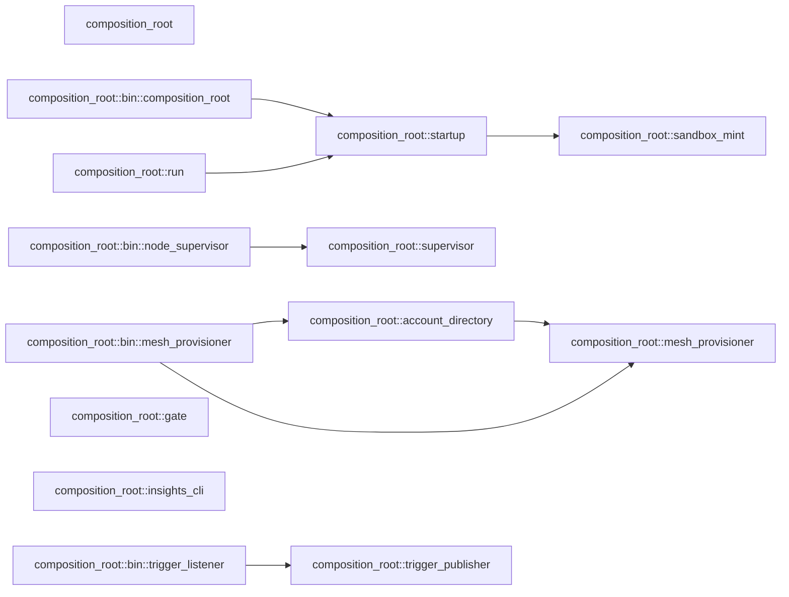

# c3 — Components: `composition_root`

Derived, not authored: the Mermaid block below is the byte-for-byte output of
`python3 scripts/module_graph.py mermaid --crate composition-root`, and
`scripts/module_graph.py check --against docs/architecture/c3-components-composition-root.md`
regenerates it from the tree and refuses this file the moment the two
disagree. The fan table is this crate's rows of
`python3 scripts/module_graph.py table`, in the same module order the table
command already sorts them in.

## Fan table

| module | fan_out | fan_in | instability |
|---|---|---|---|
| composition_root | 0 | 0 | 0.000 |
| composition_root::account_directory | 12 | 1 | 0.923 |
| composition_root::bin::composition_root | 3 | 0 | 1.000 |
| composition_root::bin::mesh_provisioner | 9 | 0 | 1.000 |
| composition_root::bin::node_supervisor | 2 | 0 | 1.000 |
| composition_root::bin::trigger_listener | 8 | 0 | 1.000 |
| composition_root::gate | 3 | 0 | 1.000 |
| composition_root::insights_cli | 3 | 0 | 1.000 |
| composition_root::mesh_provisioner | 11 | 2 | 0.846 |
| composition_root::run | 75 | 0 | 1.000 |
| composition_root::sandbox_mint | 5 | 1 | 0.833 |
| composition_root::startup | 9 | 2 | 0.818 |
| composition_root::supervisor | 1 | 1 | 0.500 |
| composition_root::trigger_publisher | 13 | 1 | 0.929 |
