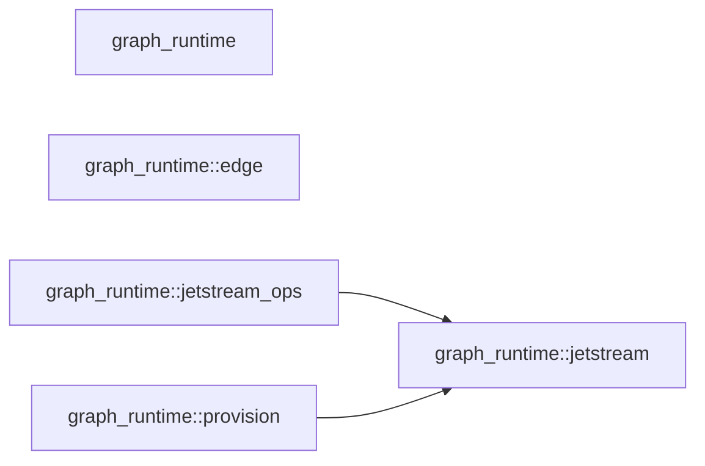

# c3 — Components: `graph_runtime`

Derived, not authored: the Mermaid block below is the byte-for-byte output of
`python3 scripts/module_graph.py mermaid --crate graph-runtime`, and
`scripts/module_graph.py check --against docs/architecture/c3-components-graph-runtime.md`
regenerates it from the tree and refuses this file the moment the two
disagree. The fan table is this crate's rows of
`python3 scripts/module_graph.py table`, in the same module order the table
command already sorts them in.

## Fan table

| module | fan_out | fan_in | instability |
|---|---|---|---|
| graph_runtime | 0 | 0 | 0.000 |
| graph_runtime::edge | 2 | 2 | 0.500 |
| graph_runtime::jetstream | 5 | 5 | 0.500 |
| graph_runtime::jetstream_ops | 5 | 2 | 0.714 |
| graph_runtime::provision | 5 | 2 | 0.714 |

