# c3 — Components: `platform`

Derived, not authored: the Mermaid block below is the byte-for-byte output of
`python3 scripts/module_graph.py mermaid --crate platform`, and
`scripts/module_graph.py check --against docs/architecture/c3-components-platform.md`
regenerates it from the tree and refuses this file the moment the two
disagree. The fan table is this crate's rows of
`python3 scripts/module_graph.py table`, in the same module order the table
command already sorts them in.

```mermaid
%% module_graph: platform
graph LR
    platform["platform"]
    platform__artifact_fs["platform::artifact_fs"]
    platform__askpass["platform::askpass"]
    platform__audit_chat["platform::audit_chat"]
    platform__bin__cloud_values["platform::bin::cloud_values"]
    platform__bin__git_askpass["platform::bin::git_askpass"]
    platform__bin__license_check["platform::bin::license_check"]
    platform__bin__llm_gateway["platform::bin::llm_gateway"]
    platform__bin__nats_auth_callout["platform::bin::nats_auth_callout"]
    platform__bin__nats_issuer_keygen["platform::bin::nats_issuer_keygen"]
    platform__bin__nats_operator_keygen["platform::bin::nats_operator_keygen"]
    platform__client_secrets_admin["platform::client_secrets_admin"]
    platform__client_secrets_bao["platform::client_secrets_bao"]
    platform__cloud["platform::cloud"]
    platform__cloud__bootstrap["platform::cloud::bootstrap"]
    platform__cloud__credential["platform::cloud::credential"]
    platform__cloud__fallback["platform::cloud::fallback"]
    platform__cloud__gcp["platform::cloud::gcp"]
    platform__cloud__local["platform::cloud::local"]
    platform__cloud__selection["platform::cloud::selection"]
    platform__db["platform::db"]
    platform__github["platform::github"]
    platform__http_url["platform::http_url"]
    platform__license["platform::license"]
    platform__litellm["platform::litellm"]
    platform__llm_gateway["platform::llm_gateway"]
    platform__llm_gateway__addresses["platform::llm_gateway::addresses"]
    platform__llm_gateway__backpressure["platform::llm_gateway::backpressure"]
    platform__llm_gateway__queue["platform::llm_gateway::queue"]
    platform__llm_gateway__retry["platform::llm_gateway::retry"]
    platform__llm_gateway__revocations["platform::llm_gateway::revocations"]
    platform__llm_gateway__service["platform::llm_gateway::service"]
    platform__nats_accounts["platform::nats_accounts"]
    platform__nats_auth["platform::nats_auth"]
    platform__parameters["platform::parameters"]
    platform__pool_metrics["platform::pool_metrics"]
    platform__provider_usage["platform::provider_usage"]
    platform__secrets_file["platform::secrets_file"]
    platform__service_start["platform::service_start"]
    platform__stubs["platform::stubs"]
    platform__stubs__artifact_store["platform::stubs::artifact_store"]
    platform__stubs__chat["platform::stubs::chat"]
    platform__stubs__client_secrets["platform::stubs::client_secrets"]
    platform__stubs__counter["platform::stubs::counter"]
    platform__stubs__git_host["platform::stubs::git_host"]
    platform__stubs__llm["platform::stubs::llm"]
    platform__stubs__parameters["platform::stubs::parameters"]
    platform__stubs__search["platform::stubs::search"]
    platform__stubs__secrets["platform::stubs::secrets"]
    platform__stubs__ticketing["platform::stubs::ticketing"]
    platform__stubs__trigger_source["platform::stubs::trigger_source"]
    platform__telemetry["platform::telemetry"]
    platform__test_graphs["platform::test_graphs"]
    platform__trigger_listener["platform::trigger_listener"]
    platform__trigger_registry["platform::trigger_registry"]
    platform__trigger_schedule["platform::trigger_schedule"]
    platform__trigger_sources["platform::trigger_sources"]
    platform__usage["platform::usage"]
    platform__artifact_fs --> platform__db
    platform__bin__cloud_values --> platform__cloud__bootstrap
    platform__bin__cloud_values --> platform__cloud__local
    platform__bin__cloud_values --> platform__cloud__selection
    platform__bin__git_askpass --> platform__askpass
    platform__bin__git_askpass --> platform__cloud__local
    platform__bin__git_askpass --> platform__cloud__selection
    platform__bin__llm_gateway --> platform__llm_gateway
    platform__bin__llm_gateway --> platform__llm_gateway__addresses
    platform__bin__llm_gateway --> platform__llm_gateway__revocations
    platform__bin__llm_gateway --> platform__llm_gateway__service
    platform__bin__nats_auth_callout --> platform__db
    platform__bin__nats_auth_callout --> platform__nats_accounts
    platform__bin__nats_auth_callout --> platform__nats_auth
    platform__bin__nats_auth_callout --> platform__service_start
    platform__bin__nats_auth_callout --> platform__telemetry
    platform__bin__nats_issuer_keygen --> platform__nats_auth
    platform__bin__nats_operator_keygen --> platform__nats_accounts
    platform__bin__nats_operator_keygen --> platform__nats_auth
    platform__bin__nats_operator_keygen --> platform__service_start
    platform__client_secrets_admin --> platform__client_secrets_bao
    platform__client_secrets_admin --> platform__db
    platform__cloud --> platform__cloud__credential
    platform__cloud --> platform__cloud__fallback
    platform__cloud --> platform__cloud__gcp
    platform__cloud --> platform__cloud__local
    platform__cloud --> platform__cloud__selection
    platform__cloud__gcp --> platform__cloud__credential
    platform__cloud__local --> platform__secrets_file
    platform__cloud__selection --> platform__cloud__credential
    platform__cloud__selection --> platform__cloud__fallback
    platform__cloud__selection --> platform__cloud__gcp
    platform__cloud__selection --> platform__cloud__local
    platform__cloud__selection --> platform__parameters
    platform__db --> platform__pool_metrics
    platform__github -.-> platform__askpass
    platform__litellm -.-> platform__llm_gateway__service
    platform__litellm --> platform__provider_usage
    platform__llm_gateway --> platform__llm_gateway__backpressure
    platform__llm_gateway --> platform__llm_gateway__retry
    platform__llm_gateway__service --> platform__llm_gateway
    platform__llm_gateway__service --> platform__llm_gateway__backpressure
    platform__llm_gateway__service --> platform__llm_gateway__queue
    platform__llm_gateway__service --> platform__llm_gateway__retry
    platform__llm_gateway__service --> platform__llm_gateway__revocations
    platform__nats_accounts --> platform__db
    platform__nats_accounts --> platform__nats_auth
    platform__nats_auth --> platform__db
    platform__pool_metrics --> platform__db
    platform__stubs__artifact_store --> platform__stubs
    platform__stubs__chat --> platform__stubs
    platform__stubs__client_secrets --> platform__stubs
    platform__stubs__git_host --> platform__stubs
    platform__stubs__git_host --> platform__stubs__counter
    platform__stubs__llm --> platform__stubs
    platform__stubs__llm --> platform__stubs__counter
    platform__stubs__parameters --> platform__stubs
    platform__stubs__search --> platform__stubs
    platform__stubs__secrets --> platform__stubs
    platform__stubs__ticketing --> platform__stubs
    platform__stubs__trigger_source --> platform__stubs
    platform__telemetry --> platform__pool_metrics
    platform__telemetry --> platform__service_start
    platform__test_graphs --> platform__stubs__secrets
    platform__test_graphs --> platform__trigger_registry
    platform__trigger_listener --> platform__trigger_registry
    platform__trigger_listener --> platform__trigger_sources
    platform__trigger_registry --> platform__db
    platform__trigger_schedule --> platform__db
    platform__trigger_schedule --> platform__trigger_listener
```

## Fan table

| module | fan_out | fan_in | instability |
|---|---|---|---|
| platform | 0 | 0 | 0.000 |
| platform::artifact_fs | 5 | 1 | 0.833 |
| platform::askpass | 3 | 2 | 0.600 |
| platform::audit_chat | 3 | 1 | 0.750 |
| platform::bin::cloud_values | 3 | 0 | 1.000 |
| platform::bin::git_askpass | 5 | 0 | 1.000 |
| platform::bin::license_check | 0 | 0 | 0.000 |
| platform::bin::llm_gateway | 4 | 0 | 1.000 |
| platform::bin::nats_auth_callout | 10 | 0 | 1.000 |
| platform::bin::nats_issuer_keygen | 1 | 0 | 1.000 |
| platform::bin::nats_operator_keygen | 4 | 0 | 1.000 |
| platform::client_secrets_admin | 7 | 0 | 1.000 |
| platform::client_secrets_bao | 4 | 1 | 0.800 |
| platform::cloud | 5 | 0 | 1.000 |
| platform::cloud::bootstrap | 3 | 1 | 0.750 |
| platform::cloud::credential | 0 | 3 | 0.000 |
| platform::cloud::fallback | 3 | 2 | 0.600 |
| platform::cloud::gcp | 4 | 2 | 0.667 |
| platform::cloud::local | 4 | 6 | 0.400 |
| platform::cloud::selection | 7 | 5 | 0.583 |
| platform::db | 7 | 12 | 0.368 |
| platform::github | 4 | 1 | 0.800 |
| platform::http_url | 0 | 0 | 0.000 |
| platform::license | 0 | 0 | 0.000 |
| platform::litellm | 7 | 1 | 0.875 |
| platform::llm_gateway | 2 | 2 | 0.500 |
| platform::llm_gateway::addresses | 1 | 1 | 0.500 |
| platform::llm_gateway::backpressure | 0 | 2 | 0.000 |
| platform::llm_gateway::queue | 1 | 1 | 0.500 |
| platform::llm_gateway::retry | 0 | 2 | 0.000 |
| platform::llm_gateway::revocations | 0 | 2 | 0.000 |
| platform::llm_gateway::service | 6 | 2 | 0.750 |
| platform::nats_accounts | 8 | 3 | 0.727 |
| platform::nats_auth | 7 | 9 | 0.438 |
| platform::parameters | 1 | 1 | 0.500 |
| platform::pool_metrics | 1 | 2 | 0.333 |
| platform::provider_usage | 1 | 1 | 0.500 |
| platform::secrets_file | 1 | 1 | 0.500 |
| platform::service_start | 0 | 5 | 0.000 |
| platform::stubs | 0 | 10 | 0.000 |
| platform::stubs::artifact_store | 2 | 0 | 1.000 |
| platform::stubs::chat | 2 | 0 | 1.000 |
| platform::stubs::client_secrets | 6 | 0 | 1.000 |
| platform::stubs::counter | 0 | 2 | 0.000 |
| platform::stubs::git_host | 3 | 0 | 1.000 |
| platform::stubs::llm | 3 | 0 | 1.000 |
| platform::stubs::parameters | 2 | 0 | 1.000 |
| platform::stubs::search | 2 | 0 | 1.000 |
| platform::stubs::secrets | 2 | 1 | 0.667 |
| platform::stubs::ticketing | 2 | 0 | 1.000 |
| platform::stubs::trigger_source | 2 | 0 | 1.000 |
| platform::telemetry | 4 | 3 | 0.571 |
| platform::test_graphs | 8 | 0 | 1.000 |
| platform::trigger_listener | 10 | 3 | 0.769 |
| platform::trigger_registry | 6 | 3 | 0.667 |
| platform::trigger_schedule | 6 | 1 | 0.857 |
| platform::trigger_sources | 3 | 1 | 0.750 |
| platform::usage | 1 | 0 | 1.000 |

