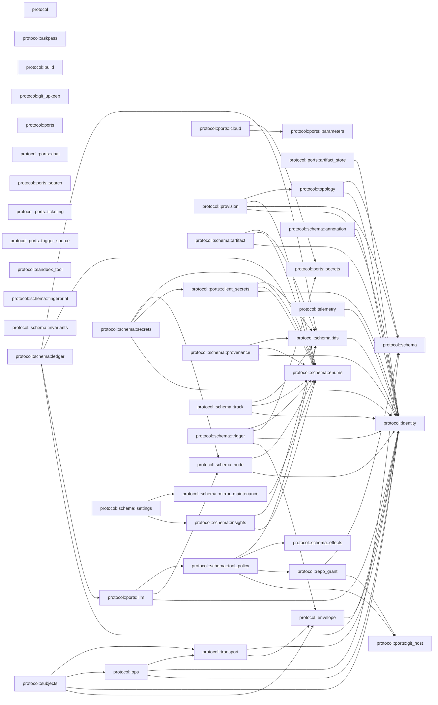

# c3 — Components: `protocol`

Derived, not authored: the Mermaid block below is the byte-for-byte output of
`python3 scripts/module_graph.py mermaid --crate protocol`, and
`scripts/module_graph.py check --against docs/architecture/c3-components-protocol.md`
regenerates it from the tree and refuses this file the moment the two
disagree. The fan table is this crate's rows of
`python3 scripts/module_graph.py table`, in the same module order the table
command already sorts them in.

## Fan table

| module | fan_out | fan_in | instability |
|---|---|---|---|
| protocol | 0 | 0 | 0.000 |
| protocol::askpass | 0 | 2 | 0.000 |
| protocol::build | 0 | 1 | 0.000 |
| protocol::envelope | 1 | 10 | 0.091 |
| protocol::git_upkeep | 0 | 2 | 0.000 |
| protocol::identity | 0 | 64 | 0.000 |
| protocol::ops | 3 | 8 | 0.273 |
| protocol::ports | 0 | 0 | 0.000 |
| protocol::ports::artifact_store | 1 | 12 | 0.077 |
| protocol::ports::chat | 0 | 5 | 0.000 |
| protocol::ports::client_secrets | 3 | 5 | 0.375 |
| protocol::ports::cloud | 2 | 8 | 0.200 |
| protocol::ports::git_host | 0 | 11 | 0.000 |
| protocol::ports::llm | 3 | 21 | 0.125 |
| protocol::ports::parameters | 0 | 12 | 0.000 |
| protocol::ports::search | 0 | 1 | 0.000 |
| protocol::ports::secrets | 0 | 18 | 0.000 |
| protocol::ports::ticketing | 0 | 1 | 0.000 |
| protocol::ports::trigger_source | 0 | 1 | 0.000 |
| protocol::provision | 3 | 4 | 0.429 |
| protocol::repo_grant | 2 | 3 | 0.400 |
| protocol::sandbox_tool | 0 | 9 | 0.000 |
| protocol::schema | 0 | 66 | 0.000 |
| protocol::schema::annotation | 1 | 0 | 1.000 |
| protocol::schema::artifact | 3 | 0 | 1.000 |
| protocol::schema::effects | 0 | 1 | 0.000 |
| protocol::schema::enums | 0 | 12 | 0.000 |
| protocol::schema::fingerprint | 0 | 3 | 0.000 |
| protocol::schema::ids | 1 | 9 | 0.100 |
| protocol::schema::insights | 2 | 3 | 0.400 |
| protocol::schema::invariants | 0 | 1 | 0.000 |
| protocol::schema::ledger | 4 | 0 | 1.000 |
| protocol::schema::node | 2 | 6 | 0.250 |
| protocol::schema::provenance | 3 | 0 | 1.000 |
| protocol::schema::secrets | 4 | 0 | 1.000 |
| protocol::schema::settings | 1 | 2 | 0.333 |
| protocol::schema::tool_policy | 4 | 6 | 0.400 |
| protocol::schema::track | 3 | 0 | 1.000 |
| protocol::subjects | 3 | 2 | 0.600 |
| protocol::telemetry | 1 | 3 | 0.250 |
| protocol::topology | 2 | 2 | 0.500 |
| protocol::transport | 2 | 15 | 0.118 |

