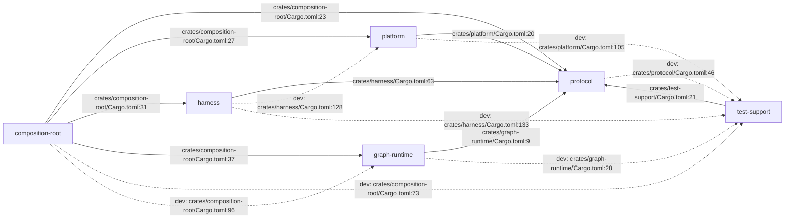

# c2 — Containers: the six crates

The Cargo workspace's six members and the dependency edges Cargo's own
resolver permits between them — every edge below is a `[dependencies]` table
entry, each anchored to the `Cargo.toml` line that declares it. That anchor
form, `crates/<crate>/Cargo.toml:<line>`, is not a `crates/<path>.rs:<line>`
anchor, so `scripts/check_diagram_anchors.py` never reads it; the line
numbers are kept right by hand, checked against `scripts/check_dep_direction.sh`
each time a manifest changes.

A dashed edge is a `[dev-dependencies]` entry: Cargo permits it, a normal
build never resolves it, and `scripts/check_dep_direction.sh` exempts every
one of them from the direction rule except where it names a cycle not on that
script's `ALLOWED_DEV_CYCLES` list.

## Notes: what `scripts/check_dep_direction.sh` enforces

The solid edges above are exactly what the script's six conditions allow —
read the script for the precise wording; this is the summary:

1. `protocol` names no workspace member under `[dependencies]` — it has none
   above, and none is legal.
2. Only `test-support` may be a `[dependencies]` entry named `test-support`;
   every other crate's edge to it, above, is a dashed `[dev-dependencies]`
   edge.
3. No crate names `harness` or `graph-runtime` under `[dependencies]`, with
   one exemption: `composition-root` may name both (ADR-0102 as W-072
   amended it — the sandbox mint constructs `FileBackend` and `Checkpointer`
   values at the root, and the run mode wires the JetStream transport, the
   inbox consumer and the supervisor there too). No other crate may name
   either; `composition-root`'s dashed edge to `graph-runtime` is its
   remaining `[dev-dependencies]` entry.
4. No crate but `composition-root` may name `platform` under
   `[dependencies]` (decision Q11 — adapters are wired at a composition
   root).
5. A `[dev-dependencies]` cycle must be on the script's `ALLOWED_DEV_CYCLES`
   list. The one cycle in this tree — `protocol`'s dev-dependency on
   `test-support`, which itself depends on `protocol` — is on that list
   (`crates/test-support/Cargo.toml:21` closes it back to `protocol`), the
   dev-dependency `deterministic_bytes` generator (W-037, ADR-0088) is the
   reason it exists, and no other pair in this diagram closes a cycle.
6. No crate depends on `composition-root` at all — nothing in this workspace
   names it, and no edge above points at it.
