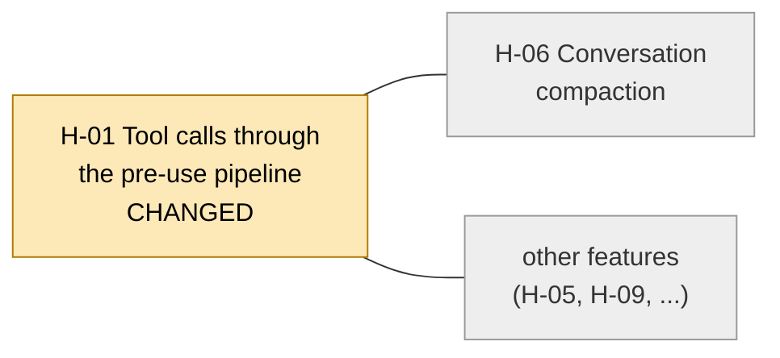
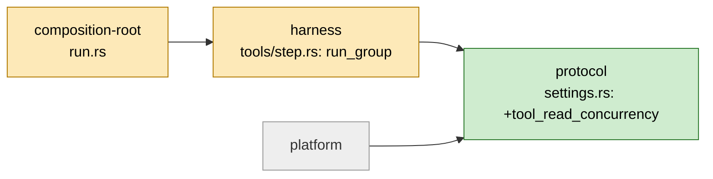

# Discussion pack for the owner: visual review of product changes

Status: PROPOSED. Nothing here is decided. Written 2026-11-12 after an audit of the corpus.
Entry points: [OVERVIEW.md](OVERVIEW.md), [OPEN-QUESTIONS.md](OPEN-QUESTIONS.md), [gaps.md](gaps.md), [CONVENTIONS.md](CONVENTIONS.md).

## A. One-page summary: what we would build and why

**The problem.** Today the owner sees a change as a plan and a contract. The owner finds UML cluttered. The owner wants to see the product change before the code is built. Reviewers say the hardest part of review is understanding the reason for a change (Bacchelli and Bird 2013, p7, checked in the PDF).

**The proposal.** A plugin sub-agent called `diagram-author`. It runs at the end of `/work-on` Phase 3, before the Phase 4 fan-out. It draws the change as three views:

1. **Feature map (L0).** The product features. The features the change touches are marked.
2. **Flow (L1).** One flow, shown before and after, with lanes and at most 12 steps.
3. **Structure (L2).** The crates and components that take part. Changed parts are marked.

Each element has a status: `added`, `changed`, `removed` or `context`. Each element points to code (`path:line`) or says it is `inferred`. The "after" side is a plan, because the stubs have no bodies. So every "after" element that no stub proves is marked `inferred`.

**How the owner uses it.** The dashboard shows the diagrams above the question card. The owner marks each element OK or not OK, and comments on single elements. One product question carries the result. The run waits for the answer.

**How it is built.** A server step extracts facts from the Rust workspace. An LLM only names and groups the facts. A validator rejects over-budget or unsupported graphs. ELK lays out the graph on the Bun server. The dashboard draws the result as hand-written SVG. Mermaid is only an export.

**Why this and not a ready tool.** No surveyed tool does all of: Rust, before/after diff, a plan-time "after" side, and the existing dashboard. OpenArc and LikeC4 give the data model and the diff words. We copy the ideas, not the tools.

**Size.** One spike (D0) and six dossiers (D1 to D6). The corpus holds no effort figures. The order is in [OVERVIEW.md](OVERVIEW.md).

**The biggest gap.** L0 needs a map from feature to code. In config-harness no such map exists. Only 6 of its 32 diagram files carry a feature ID (checked 2026-11-12). We must build the map. This is the highest risk in the plan.

## B. Decision cards, ordered by what each blocks

The corpus has no effort figures. "Cost" below is the cost the research names, in words. No number is invented.

### 1. OQ-03. How deep the Rust extraction goes in version 1

- **Question.** Which extraction layers ship first?
- **Options.** (A) Crate and module level only. (B) Also call edges from a language-server call hierarchy.
- **Recommendation.** A, plus stub signatures from the diff. Add calls after the D0 spike.
- **Cost.** A is cheap: `cargo metadata` gives the crate level, and `cargo-modules` gives modules. B needs rust-analyzer and a slow start. The `ra_ap_*` crates break on each release, so versions must be pinned.
- **Blocks.** D1 (the graph model and extraction). D1 starts the critical path D1, D2, D3. Flow steps in L1 need calls, so B decides how real the flow view is.

### 2. OQ-02. React island or hand-written canvas

- **Question.** How does the dashboard draw the canvas?
- **Options.** (A) Hand-written SVG with `@xyflow/system` helpers. (B) `@xyflow/react` as a React island.
- **Recommendation.** A first. Use B if the D0 spike shows A costs too much.
- **Cost.** A means building select, collapse and comment by hand. B adds React and a build step to a page that is one inline string with "no external resources" (`shared/questions/page.ts:1`). Audit note: `@xyflow/system` is free of React but depends on four d3 packages, so A also needs a bundling step. The corpus does not say how `page.ts` is built.
- **Blocks.** D3 (renderer). Also D4 and D5, which need a canvas to test against.

### 3. OQ-01. The "Never ask for approval" conflict

**DECIDED 2026-11-12: B, a product question** (see OPEN-QUESTIONS.md).


- **Question.** The ask policy forbids approval questions. A visual review is an approval gate.
- **Options.** (A) A named exception. (B) Frame it as a product question ("Is this what the feature should do?"). (C) No gate: show the diagrams, do not block.
- **Recommendation.** B, plus one sentence in `references/owner-questions.md` that names the visual-review question as a product question.
- **Cost.** B needs no policy change. Audit addition: code enforces the policy. `scripts/ask_owner.py` refuses approval-shaped questions under the runner (`APPROVAL_PATTERNS`, lines 135-168; `ASD_ASK_LINT=0` turns it off). B must avoid those phrases. A would also need a lint change. C loses the point of reviewing before the fan-out.
- **Blocks.** D4 (verdicts) and OQ-08 (a default for an unanswered question).

### 4. OQ-06. Size gate

**DECIDED 2026-11-12: every build** at first (see OPEN-QUESTIONS.md).


- **Question.** Does every build get a visual review?
- **Options.** (A) Every build. (B) Builds above a size. (C) An owner switch per dossier.
- **Recommendation.** A at first, so the measures in [Q9](../visual-review/research/synthesis/q9-measuring-value.md) get data. Add a gate later.
- **Cost.** A adds one agent run and one owner answer to every build. `contract-reviewer` also has no size gate (`references/work-on/phase-3.md:6-8`), so A matches precedent.
- **Blocks.** D5 (the agent and the `VISUAL-REVIEW:` gate) and the value measurements.

### 5. OQ-05. Where the committed map lives

- **Question.** Where does the product layer of the map live in the target repo?
- **Options.** (A) `docs/architecture/`. (B) A new `.visual-review/` folder.
- **Recommendation.** A. The anchor checker already covers that folder in config-harness.
- **Cost.** A mixes generated and hand-written files. B needs a new checker.
- **Blocks.** D6 (living map). The D1 schema also needs to know where to write.

### 6. OQ-09. First-run scope of the product map

- **Question.** Does the first run map the whole repo?
- **Options.** (A) Whole repo. (B) Per feature, as changes touch it.
- **Recommendation.** B.
- **Cost.** A may cost many tokens, and no measurement exists. B grows the map slowly, so L0 is incomplete at first and its recall is low.
- **Blocks.** D6 and the quality of L0 in the first weeks.

### 7. OQ-10. Languages after Rust

- **Question.** Does version 1 have a language plug-in interface?
- **Options.** (A) Rust only. (B) A plug-in interface from day one.
- **Recommendation.** A. Write the graph schema language-neutral so a later plug-in fits.
- **Cost.** B adds design work before any value is shown.
- **Blocks.** Only the shape of the D1 schema.

### 8. OQ-08. Time-boxed default for an unanswered question

- **Question.** What happens if the owner does not answer?
- **Options.** (A) Block until answered. (B) Continue with the recommendation after N hours and log it.
- **Recommendation.** A, until OQ-01 is settled.
- **Cost.** A can stall a run. B is an approval by default, which conflicts with the ask policy.
- **Blocks.** Nothing in the build. It blocks unattended runs.

### 9. OQ-07. Recall threshold for the L0 map

- **Question.** What share of touched features must the L0 map mark?
- **Options.** Any value the owner picks, for example 9 of 10.
- **Recommendation.** Set it after the first eval set of 10 changes exists.
- **Cost.** Building the eval set. The set needs a known list of touched features for each change.
- **Blocks.** The acceptance of D1 and D5 on L0 quality.

### 10. OQ-04. A light version in `/plan`

- **Question.** Does `/plan` also show a light view?
- **Options.** (A) Phase 3 only. (B) Phase 3 plus a plan-time view.
- **Recommendation.** A for version 1.
- **Cost.** B means a second place to maintain.
- **Blocks.** Nothing.

## C. Sketches (not real output)

These sketches are drawn by hand from the config-harness git log and dossier W-145 ("Consecutive read-only tool calls of one model response run concurrently, and their results join the conversation in call order", merged 2026-11-07). The tool does not exist yet. The real output will differ. Source facts: `.discovery/dossiers/W-145-*.md` anchors, `docs/architecture/seq-tool-call.md:86,138-140`, `crates/protocol/src/schema/settings.rs:218`.

### C1. L0 feature map with change status

Only two feature names come from the repo (H-01 and H-06 in `seq-tool-call.md`). The other boxes are placeholders. Today no feature-to-code map exists, so this view needs the D1 and D6 work.



Legend: amber is changed, grey is context. Every changed box links to a code list (L3). Here: `crates/harness/src/tools/step.rs`, `crates/protocol/src/schema/settings.rs`.

### C2. L1 before and after flow (one merged graph)

Status marks are text here: `[=]` unchanged, `[~]` changed, `[+]` added. The "after" steps are `inferred` until a stub proves them.

```text
Lane: Step (harness)                    BEFORE                    AFTER
 1  loop each call in response          [=] in order              [=] in order
 2  decide phase                        [=] per call              [~] in call order, for a group
 3  group consecutive read-only calls   --                        [+] inferred  "run_group" (step.rs:1816)
 4  Tool::run                           [=] one at a time         [~] up to tool_read_concurrency at once
 5  settle phase / join into chat       [=] per call              [~] in call order after the group
Lane: Settings (protocol)
 6  tool_read_concurrency (default 4)   --                        [+] new setting, 1 to 64
```

### C3. L2 structure with status (crates)



Audit note: config-harness has 10 workspace members. Its c2 diagram still says "six" and omits `fault` and `step-timing`. A tool that extracts crates from `cargo metadata` would show all 10 at once.

## D. Audit results

Checked 2026-11-12. Config-harness was read only, at commit `56034559` (branch `development`). PDFs were read with PyMuPDF text extraction. Clone code was read in place.

### D1. Structure audit (against [CONVENTIONS.md](CONVENTIONS.md))

- 19 paper docs, 19 PDFs, one to one. All 19 have the six template headings. All have the PDF path and it exists.
- 22 source docs follow the template. `Comparison` is optional by the rules. Four had missing sections, now fixed: `code-graph-mcp-servers`, `diagram-diff-approaches` and `trace-to-sequence-and-sequence-generators` lacked "Development resources", and `diagram-diff-approaches` lacked "Alternatives".
- Every recommendation starts with USE, BUILD or SKIP (bold). Checked in all 22 source docs.
- Indexes: `papers/README.md`, `sources/README.md`, `synthesis/README.md` and `inspiration-repos/CLAUDE.md` list exactly the docs present. No missing and no extra entry.
- All relative links resolve (every `.md` under `research/`, `visual-review/`, `inspiration-repos/analysis/`). Every URL in the docs appears in `LINKS.md`.
- All 6 feature folders have the 6 required docs.
- All 48 `path:line` references to the plugin repo are within the file length. The file-content spot checks all matched.
- Not checked: sentence length (25 words) across all 90 documents. Only the paper docs were scanned (no sentence above 25 words, apart from one table line each).

### D2. Findings audit

Verdicts: CONFIRMED, WEAKER THAN STATED, UNSUPPORTED. "Fixed" means the corpus text was corrected or caveated in this commit.

| # | Claim (where it is used) | Verdict | Evidence location |
|---|---|---|---|
| 1 | Reflexion models: three-valued converge, diverge, absent; NetBSD 250,000 lines of C (DR-02, Q2) | CONFIRMED | PDF `reflexion-models-murphy-1995` p1, p3-4 |
| 2 | Understanding the reason for a change is the hardest part of review (DR-01, Q9) | CONFIRMED | PDF `modern-code-review-bacchelli-bird-2013` p7 |
| 3 | File-order survey: 1,355 developers, 10.2%, 57.6%, 63.9% | CONFIRMED | PDF `file-ordering-code-review` p1 |
| 4 | SADU: 154 diagrams, 2,431 tasks, best model 70.18%, weakest 17.77% (Q9: check accuracy on data, not on pictures) | CONFIRMED | PDF `vlm-architecture-diagram-understanding` p1 |
| 5 | Summarised sequence diagrams: F 0.670, recall 0.793, against 0.421 and 0.670, under the condition "#lifelines < 30" (DR-04, Q4) | CONFIRMED, and the corpus caveat is right | PDF `summarized-sequence-diagram-objects` p1 |
| 6 | One trace of over 100,000 lines has only 65 distinct methods (Q4) | CONFIRMED | PDF `trace-complexity-reduction-hamou-lhadj-2003` p4 |
| 7 | Edge bundling strength beta in [0,1] (Q4) | CONFIRMED | PDF `hierarchical-edge-bundles-holten-2006` p3 |
| 8 | Review comprehension: 10 reviewers, 25 reviews, context-building phase | CONFIRMED | PDF `code-review-comprehension-strategies` p1 |
| 9 | Feature location survey: 89 articles, 25 venues | CONFIRMED | PDF `feature-location-survey-dit-2013` p1-2 |
| 10 | ArchAgent: +0.21 max F1 gap, 8 repos, 30 participants; CIAO 22 developers; AgenticAKM 29 repos | CONFIRMED | PDFs p1, p3-4 |
| 11 | "Crate boundaries are strong cues, folders weak" cited to ASNER (Q3) | WEAKER THAN STATED. ASNER says only "weak directory cues". The crate claim is an inference. Fixed. | PDF `asner-architecture-recovery` p1; `q3-extraction-from-rust.md` |
| 12 | "A diff needs a legend" cited to evolution storyboards (Q2) | WEAKER THAN STATED. The paper has a reading guideline (p5), no legend. Fixed. | PDF `evolution-storyboards-beyer-hassan-2006` p5; `q2-diff-model.md` |
| 13 | DR-02: OpenArc statuses `added/changed/removed/context`, edge `resolution` static/dispatch/inferred, one hop of context | CONFIRMED | `inspiration-repos/openarc/spec/graph.schema.json:33,100`; `spec/graph.md:22` |
| 14 | DR-02: LikeC4 modes as-is, changes, to-be; a removed element must exist, an added one must not | CONFIRMED | `likec4/.../model-diff/compare-view.ts`; `apps/docs/.../dsl/diff.mdx` "Validation"; `language-server/src/validation/diff.ts` |
| 15 | CodeBoarding five change statuses; sha16 fingerprints; `.codeboarding/` tracked | CONFIRMED | `CodeBoarding/agents/change_status.py`; `codeboarding_workflows/fingerprint_diff.py`; `git ls-files .codeboarding` |
| 16 | mermaidiff: 12-step cap, tiers never move up, plan mode marks "after" as inferred | CONFIRMED | `mermaidiff/skill/format.md:24,27`; `skill/SKILL.md:43` |
| 17 | mermaidiff "10 of 10, 0 false positives" (Q9) | WEAKER THAN STATED. Self-reported by the author, on FastAPI, gin and excalidraw. Not Rust, not independent. Fixed. | `mermaidiff/README.md:52` |
| 18 | DR-02 layout stability: ELK `considerModelOrder` keeps order stable | WEAKER THAN STATED. OpenArc turns it off above a node threshold. Stability is not shown for large graphs. Fixed. | `openarc/viewer/src/place.ts:36-43` |
| 19 | DR-03: cargo-modules flags, cycle detection, MPL-2.0, `ra_ap_*` pinned `=0.0.358`, no JSON output | CONFIRMED | `cargo-modules/README.md`, `Cargo.toml:8,31-41` |
| 20 | DR-05: ELK runs in Node at build time (OpenArc) | CONFIRMED | `openarc/tools/layout.ts:50-52`, `vendor/elkjs/` |
| 21 | DR-05: "USE ELK on the Bun server" | UNSUPPORTED. Not tested. The elkjs README documents Node and lists a "Can't resolve web-worker" issue. The corpus already says so in `gaps.md`. The D0 spike must settle it. | `elkjs/README.md:33`; [gaps.md](gaps.md) |
| 22 | DR-05: LikeC4 sequence layouter is 889 lines | CONFIRMED | `likec4/packages/layouts/src/sequence/layouter.ts` |
| 23 | DR-05: `@xyflow/system` is framework-free | CONFIRMED, with a cost the corpus omits: it depends on four d3 packages | `xyflow/packages/system/package.json:52-61` |
| 24 | DR-06: the policy says "Never ask for approval" | CONFIRMED, but the corpus omits that code enforces it. Fixed. | `references/owner-questions.md:96`; `scripts/ask_owner.py:135-168` |
| 25 | DR-07: Phase 3 runs `contract-reviewer` before the fan-out; no size gate; `--pre-fanout` validator exists | CONFIRMED | `references/work-on/phase-3.md:4-13`; `scripts/validate_pipeline.py:2999` |
| 26 | DR-06/07: dashboard page has no external resources; `Line` allows extra keys | CONFIRMED | `shared/questions/page.ts:1`; `shared/questions/store.ts:6-12` |
| 27 | DR-08: Understand-Anything fingerprints, change classifier, staleness, committed graph | CONFIRMED | `Understand-Anything/.../packages/core/src/fingerprint.ts`, `README.md:320` |
| 28 | DR-08: c2 says "six members", workspace has 10 | CONFIRMED | `config-harness/Cargo.toml` members; `docs/architecture/c2-containers.md:1-3` |
| 29 | DR-08: `fault` and `step-timing` appear in no diagram; `step-timing` added 2026-10-27 | CONFIRMED | `grep` over `docs/architecture/`; `git log --diff-filter=A` |
| 30 | DR-08: c2 anchors `harness/Cargo.toml:63`, `graph-runtime/Cargo.toml:9`, `composition-root/Cargo.toml:27` point to comments | CONFIRMED | `sed -n` on each line |
| 31 | 32 diagram files, 38 Mermaid blocks, 5057 lines | CONFIRMED (32 files hold the 38 blocks; the threat model is prose) | `docs/architecture/` |
| 32 | "17 sequence files" (current-state, Q1) | WRONG. There are 16 files with 22 `sequenceDiagram` blocks. Fixed. | `ls docs/architecture/seq-*` |
| 33 | Only 6 of 32 files carry a feature ID; only H-01, H-05, H-06, H-09 occur | CONFIRMED (6 files count includes `README.md`) | `grep -lE 'H-[0-9][0-9]'` |
| 34 | 748 of 748 anchors valid | CONFIRMED for existence and line range (748 found, 0 missing or short). The "identifier is on the line and not a comment" rule was not re-run, because the checker script can write files. | own count over `docs/architecture/*.md` |
| 35 | DR-04: budgets of 15 features, 12 steps, 5 lanes, 12 nodes | WEAKER THAN STATED if read as evidence. They are design guesses. Only the 12-step cap has a source (mermaidiff). The one outside budget found (9 nodes, 12 edges) is lower and comes from a practitioner tool. The corpus already labels them inference. | `representations-beyond-uml.md:36-45` |
| 36 | DR-01: matrices beat node-link above about 20 nodes | WEAKER THAN STATED. It rests on search summaries, not the studies. The corpus says so. | `q1-representations.md:10` |
| 37 | DR-09: late contract changes as the value measure | UNSUPPORTED as a validated measure. It is a proxy. The corpus found no evidence that diagram review catches more defects. No baseline count exists. | `q9-measuring-value.md:7,18`; [gaps.md](gaps.md) |
| 38 | DR-01: "the owner finds UML cluttered" | Owner statement, not research. It drives the design. | `q1-representations.md:9` |
| 39 | CodeCity 41-participant result; Garcia et al. 2013 | Second-hand. The PDFs were not downloaded. Already flagged. | [gaps.md](gaps.md) |

Summary of what is weaker than the overview says:

- DR-05 "ELK on the Bun server" has no test behind it. Only Node is shown.
- DR-02 layout stability is shown for small graphs only, in the one tool that uses it.
- DR-06 ignores that code enforces the ask policy. This changes the cost of option A.
- DR-04 and DR-09 are proposals with no evidence of effect. DR-09 has no baseline.
- L0 (DR-01) depends on a feature-to-code map that does not exist.
- The papers are solid. Every number checked in a PDF matched. The weak spots are in how two papers are cited (rows 11 and 12).

## E. Proposed first step: the D0 spike

The goal: answer the open points in Q3 and Q5 before any product code ships. No product code is committed.

Checklist:

- [ ] **Bun and elkjs.** Run elkjs on the Bun server with 50, 100 and 200 nodes. Use `elk.algorithm: layered`. Record time and whether the worker loads. Fallback if Bun fails: run ELK in a Node child process. (Closes row 21.)
- [ ] **Layout stability.** Lay out a "before" and an "after" graph that differ by 3 nodes. Run once with `considerModelOrder.strategy: NODES_AND_EDGES` and once with `NONE`. Count how many unchanged nodes move, and by how far. Test above and below 100 nodes. (Closes row 18.)
- [ ] **Extraction at crate level.** Run `cargo metadata` on config-harness. Check that the crate set equals the 10 workspace members. Record the time.
- [ ] **Extraction at module level.** Run `cargo-modules dependencies` on one crate, for example `harness`. Record time, output size (DOT or text), and whether the tool loads the workspace without errors. Pin the version.
- [ ] **One deeper extractor.** Try one of: rust-analyzer call hierarchy for the functions in W-145, or an `ra_ap_*` helper. Record whether it gives the `run_group` call edges. (Answers OQ-03.)
- [ ] **Hand-built fixture.** Write the W-145 graph by hand as JSON (nodes, status, `path:line`, `resolution`). Use it in C1 to C3 above. This is the fixture for D1 and D2 as well.
- [ ] **Canvas cost.** Draw the fixture as hand-written SVG with pan and zoom from `@xyflow/system` in a single inline string. Record the code size and how `page.ts` would bundle it. (Answers OQ-02.)
- [ ] **Budget check.** Count the elements of the W-145 views. Compare with the proposed budgets (15 features, 12 steps, 12 nodes). Say if they fit.
- [ ] **Drift script slice (D6, no dependency).** Write the script that compares `Cargo.toml` `members` with the crates named in `c2-containers.md`. Run on the 2026-11-12 files. Expected: it names `fault` and `step-timing`. This is VC-01 of VR-06.
- [ ] **Recall check.** For 3 recent config-harness changes, list the touched features by hand. Note how long the feature-to-code mapping takes. This gives a first number for OQ-07 and OQ-09.
- [ ] **Report.** One short document with a number for each item. Owner decides on OQ-02 and OQ-03 from it.

Not in the spike: the agent, the gate, the verdict UI, and any change to the ask policy.
